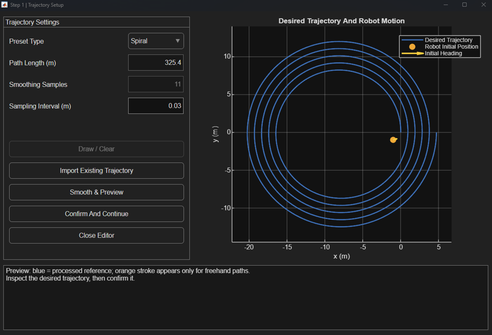
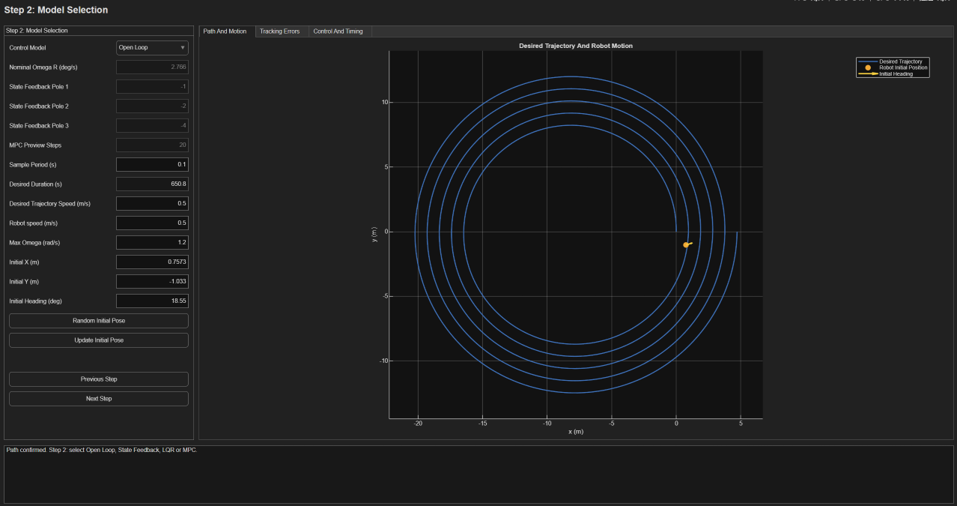
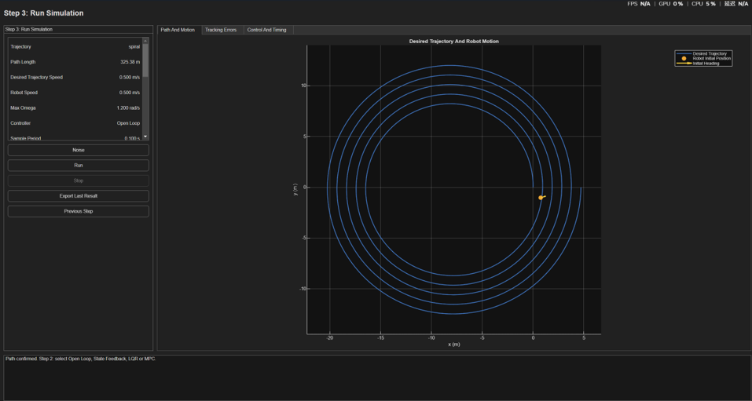

# Trajectory Following Simulation

This MATLAB and Simulink application compares Open Loop, State Feedback (SF), Linear Quadratic Regulator (LQR) and nonlinear Model Predictive Control (MPC) for a robot with fixed forward speed and controlled angular velocity. Prepare a preset or hand-drawn path, choose the controller and motion settings, run the simulation, and export the true motion and evaluation data.

This guide covers operation. See [PARAMETERS.md](PARAMETERS.md) for parameter definitions, code defaults and settings that are not exposed in the interface, and [STRUCTURE.md](STRUCTURE.md) for the program layout and call flow.

## Start the application

The project targets MATLAB R2025a. The Run button requires Simulink. SF and LQR additionally require Control System Toolbox (`place` and `lqr`); MPC requires Optimization Toolbox (`fmincon`). Keep the complete project directory together.

In MATLAB, set **Current Folder** to the directory containing `start_app.m` and `setup_paths.m`, then run:

```matlab
start_app
```

The screenshots below illustrate the three operating stages using a spiral. The app initially selects Freehand. Values visible in screenshots are examples, not a record of the settings of every experiment.

## Step 1 Prepare the trajectory



Select **Line**, **Circle**, **Spiral** or **Freehand** in **Preset Type**. Preset dimensions are configured in code; the interface does not expose a separate radius or spiral-growth field. For Freehand, use **Draw / Clear**, then press and drag inside the plot to draw one continuous stroke. A new stroke replaces the previous one. **Import Existing Trajectory** reads a numeric CSV with two columns, X and Y in metres; a headerless `trajectory_TIMESTAMP.csv` exported by this app is suitable input.

| Field or button | How to use it |
|---|---|
| Path Length (m) | Read-only processed length; updated by preview. |
| Smoothing Samples | Controls the starting smoothing strength for Freehand. Higher values can suppress more drawing jitter, subject to the shape-deviation budget. It is not a direct curvature limit. |
| Sampling Interval (m) | Spatial interval used to prepare the path, default 0.03 m. It is distinct from the control sample period in seconds. |
| Smooth & Preview | Generate the processed reference. For Freehand, compare the original orange stroke with the blue processed path. |
| Confirm And Continue | Accept the prepared path and enter Step 2. Confirmation also selects a random initial robot pose. |
| Close Editor | Exit the entire application. |

Inspect the preview before confirming. Changing the path type, spacing or smoothing invalidates the previous preparation and requires another preview and confirmation.

## Step 2 Set the controller and motion parameters



Choose the controller and review the following fields. Controls that do not apply to the selected controller are disabled.

| Parameter | Purpose and setting |
|---|---|
| Control Model | Open Loop follows the reference angular rate without error correction. SF and LQR use fixed gains. MPC optimises a nonlinear predicted response. |
| Nominal Omega R (deg/s) | A fixed SF/LQR design rate calculated from the path and reference speed. You can override it for SF/LQR. It must be nonzero. It is not the time-varying reference turning rate or the angular limit. |
| State Feedback Pole 1–3 | SF pole-placement targets. Defaults are -1, -2 and -4. They must be negative and distinct. |
| MPC Preview Steps | Prediction horizon N, default 20. With a 0.1 s sample period, the nominal prediction duration is 2 s. |
| Sample Period (s) | Controller and plant sampling interval, default 0.1 s. |
| Desired Duration (s) | Read-only path length divided by reference speed. There is no additional catch-up period. |
| Desired Trajectory Speed (m/s) | Speed of the time-indexed desired reference, default 0.5 m/s. |
| Robot speed (m/s) | Actual constant forward speed used by the robot model, default 0.5 m/s. |
| Max Omega (rad/s) | Positive magnitude of the robot angular limit. The GUI applies symmetric limits `[-Max Omega, +Max Omega]`, default ±1.2 rad/s. |
| Initial X / Initial Y (m) | To setup Robot starting position. |
| Initial Heading (deg) | Robot starting orientation. The program converts it to radians internally. |

Use **Random Initial Pose** to select another starting pose, or edit the initial-pose fields and use **Update Initial Pose** to inspect it. Random initialisation samples offsets relative to the first path point and a heading over a full revolution. When comparing controllers within one test, keep the initial pose unchanged rather than drawing a new random pose for each controller.

Changing robot or reference speed preserves the confirmed geometry. Reference-speed changes update duration and the automatic nominal turning rate. A manually overridden nominal rate is retained. Reprocessing the path restores the automatic nominal value. Changing the controller or other run settings clears the previous run result, so export a run before changing its settings.

Click **Next Step** after checking the configuration. **Previous Step** returns to the path editor.

## Step 3 Configure noise and run



Check the review panel, open **Noise** if needed, then select **Run**. The noise dialog has separate switches for Control Noise and Measurement Noise. Enter symmetric maximum errors, not variances or standard deviations:

| Noise field | Default maximum error | Meaning |
|---|---:|---|
| Control Omega Max | 0.03 rad/s | Error added to the commanded angular rate before the final physical limit. |
| X Error Max | 0.05 m | Longitudinal body-frame tracking-error measurement disturbance. |
| Y Error Max | 0.05 m | Lateral body-frame tracking-error measurement disturbance. |
| Orientation Max | 0.02 rad | Heading-error measurement disturbance. |

Apply the dialog changes before running. Each channel uses a zero-mean Gaussian parent distribution with standard deviation equal to maximum/3, rejecting samples outside the entered bounds. Most samples are near zero. Measurement noise changes feedback information. It does not directly jump the true robot pose. A zero bound disables that component. Large values are allowed by the noise fields, but change the experimental disturbance level substantially; the control-noise bound and the robot's physical angular limit are different quantities.

During a run, editable settings are disabled. **Stop** requests cancellation and takes effect between controller calls, so an ongoing MPC optimisation may finish first. The normal run ends when the desired path duration is reached. A failed or rejected controller calculation stops the run; the program does not silently switch to another controller.

## Read the displayed results

**Path And Motion** shows the desired geometry, the true simulated robot trajectory and its current heading arrow. The actual trajectory is not the MPC prediction horizon. **Tracking Errors** shows position error in metres and wrapped heading error in radians. **Control And Timing** shows actual angular velocity and controller call time in seconds, with the sample-period deadline for comparison.

The reference advances according to time, rather than waiting for the robot. A robot close to the geometric path can still have a substantial time-indexed position error. Unequal fixed robot/reference speeds generally prevent sustained exact tracking. The animation follows simulation progress and is not a guarantee of real-time playback. Measured computation time is recorded but is not inserted as an actuation delay.

## Export a run

Select **Export Last Result** after a run and before switching settings. The app writes six files with a shared timestamp to the project-root `results` directory. Repeated exports receive unique names.

| File | Contents |
|---|---|
| `trajectory_TIMESTAMP.csv` | Complete processed desired XY path, in metres, without a header. |
| `evaluation_TIMESTAMP.csv` | Configuration and summary metrics with `Metric`, `Value` and `Unit` columns. |
| `robot_trajectory_TIMESTAMP.csv` | Time, true robot pose and the sampled reference pose. |
| `errors_TIMESTAMP.csv` | Time, Euclidean position error and wrapped heading error. |
| `angular_velocity_TIMESTAMP.csv` | Time and actual angular velocity after noise and saturation. |
| `controller_timing_TIMESTAMP.csv` | Time, controller call time and sample period, all time columns in seconds. |

Heading RMSE in the evaluation table is in **degrees**; the heading-error curve CSV is in **radians**. Summary computation times are exported in **seconds**. Any comparison script converting them to milliseconds must multiply by 1000. A stopped or failed run can still contain partial data.

For a fair comparison, reuse the same confirmed path, initial pose, robot/reference speeds, sample period, angular limits, noise bounds and seed. Export each controller run separately. Controller gains and MPC settings may differ by design, but should be recorded and stated in the comparison.
